<div align="center">

  


# [澎湃音乐](https://github.com/misaka10902/HyperMusic)

#### 这是你想象中的小米音乐吗？

   

</div>

---

## 项目简介

澎湃音乐是一款基于 Jetpack Compose、Compose Miuix 和 AndroidX Media3 构建的 Android 在线音乐播放器，通过 GD API 获取在线音源，界面设计和交互全面契合小米澎湃OS，为小米用户带来更一致的听歌体验。

## 软件界面预览

### 主要页面

<table>  
  <tr>  
    <td>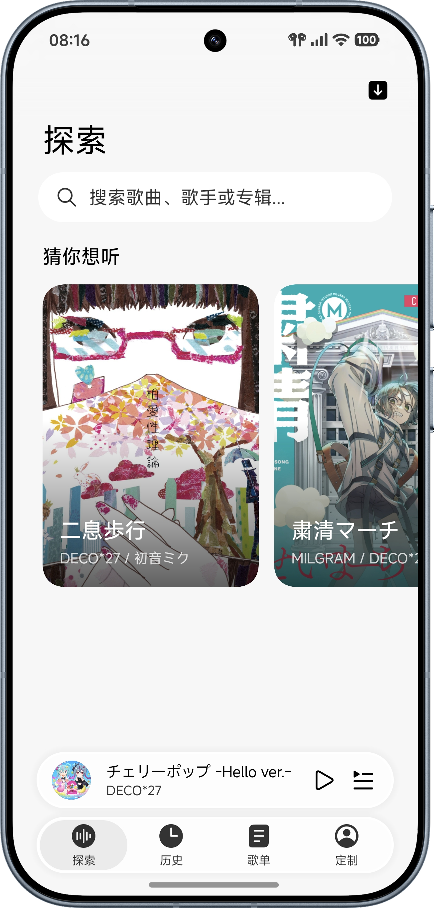</td>  
    <td>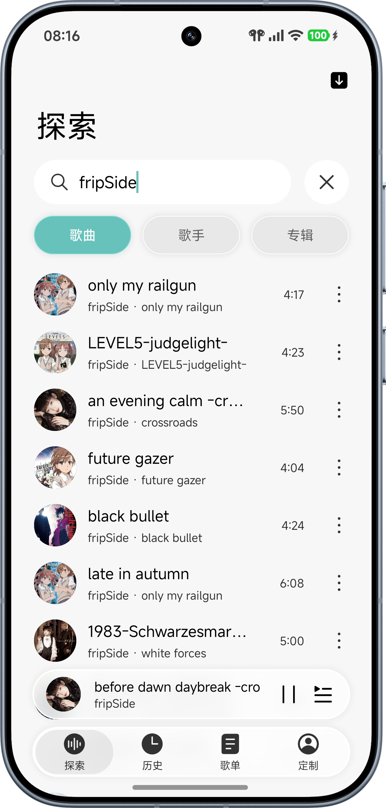</td>  
    <td>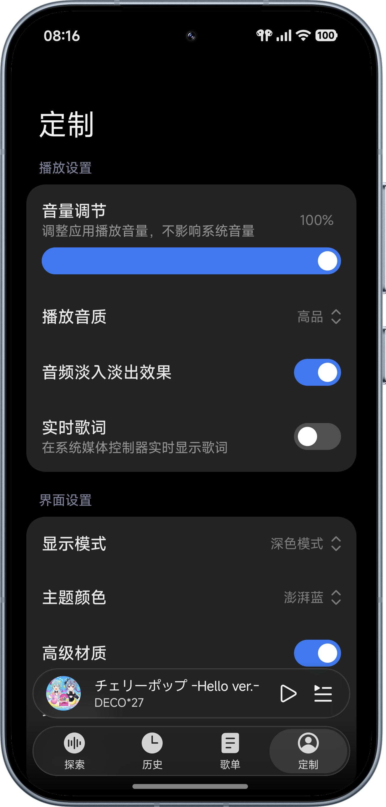</td>  
    <td>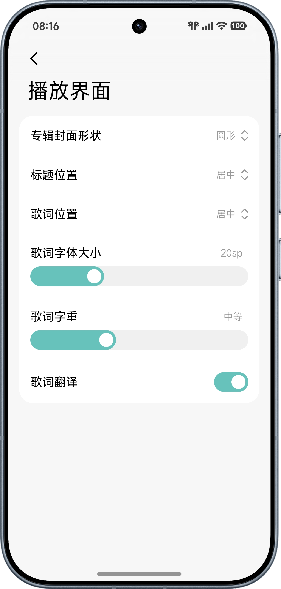</td>  
  </tr>  
  <tr>  
    <td>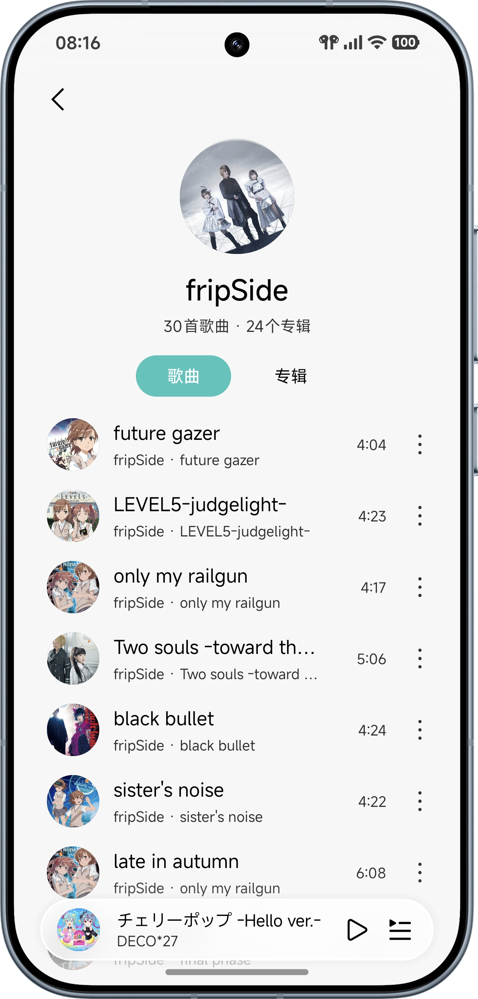</td>  
    <td>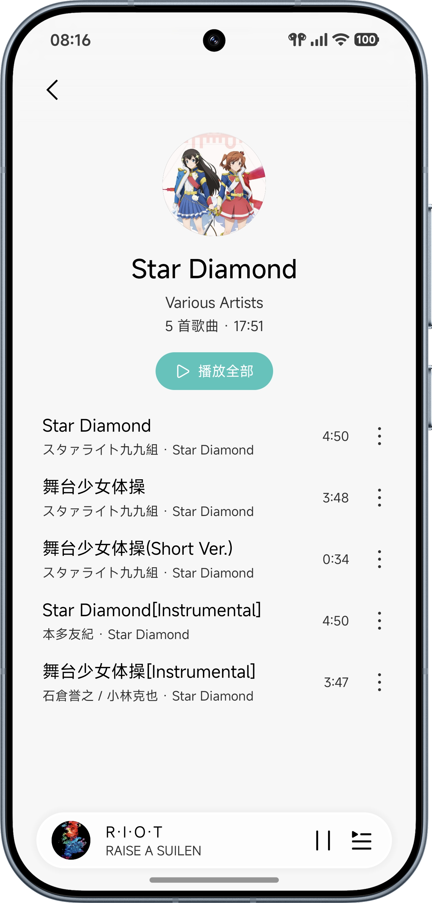</td>  
    <td>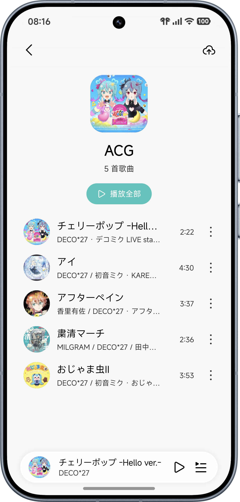</td>  
    <td>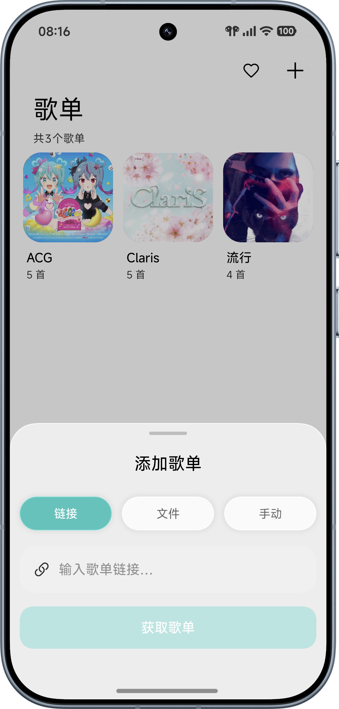</td>  
  </tr>  
  <tr>  
    <td>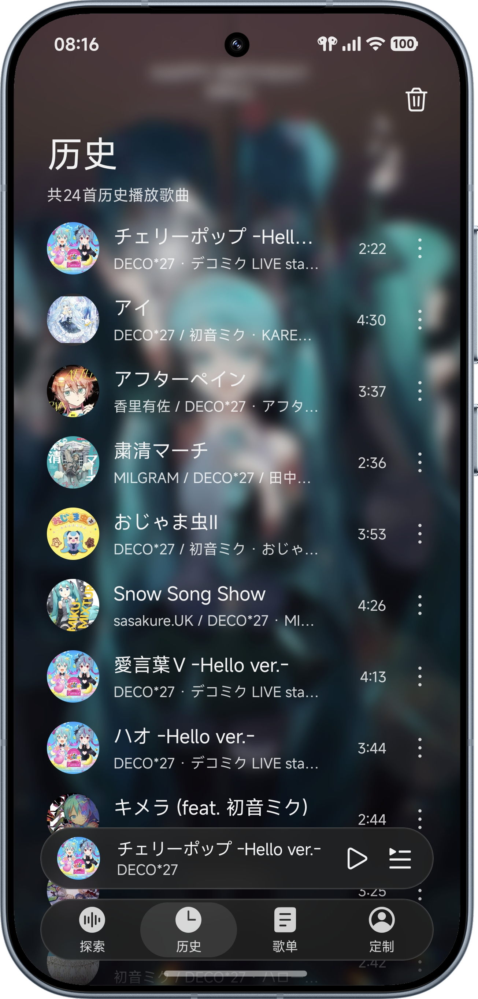</td>  
    <td>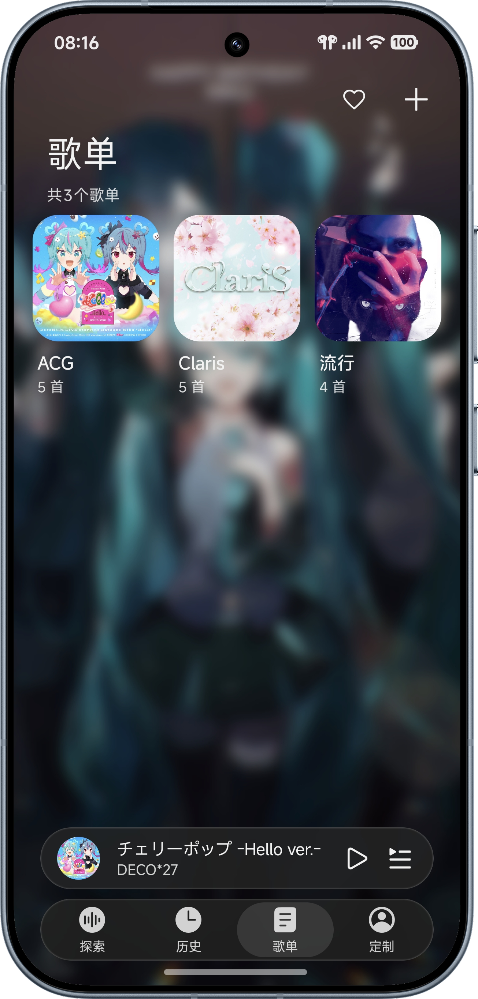</td>  
    <td>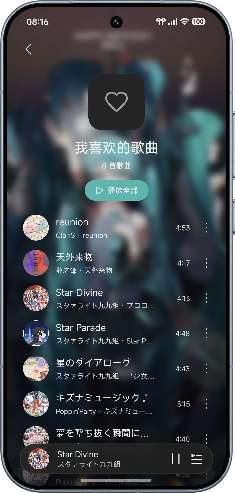</td>  
    <td>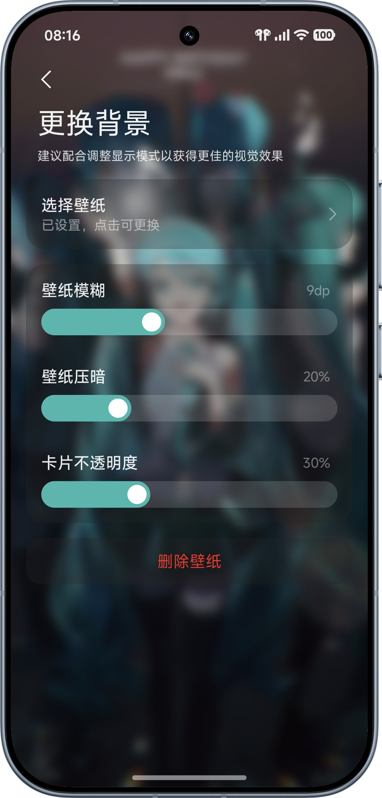</td>  
  </tr>  
</table>

### 播放页与歌词

<table>  
  <tr>  
    <td>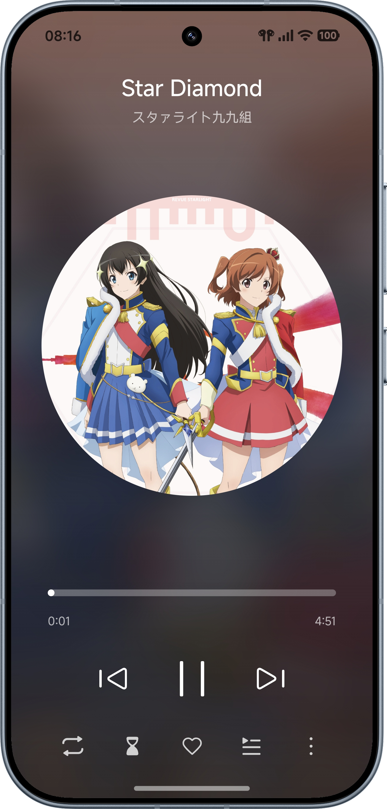</td>  
    <td>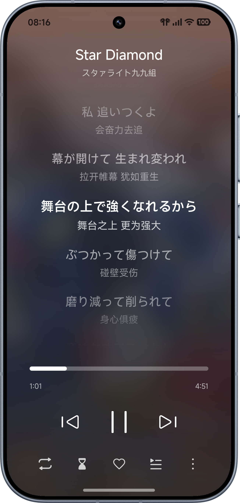</td>  
    <td>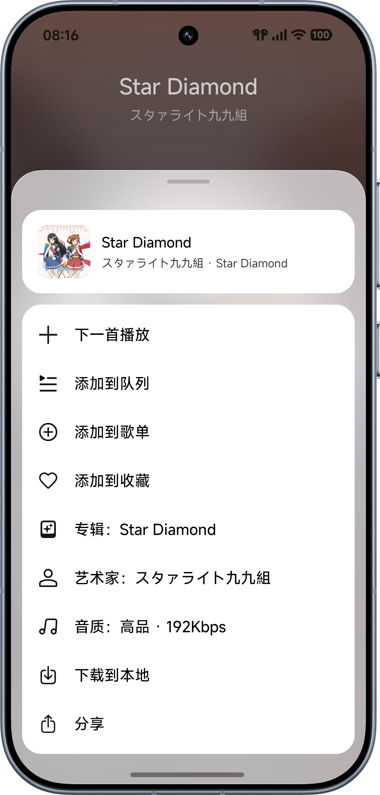</td>  
    <td>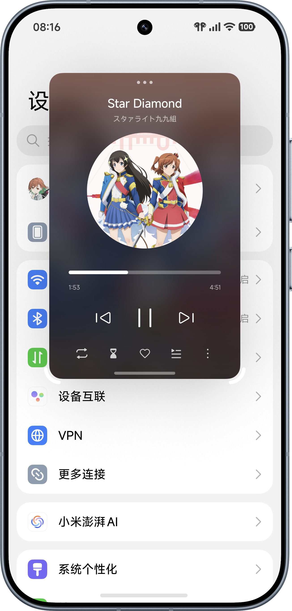</td>  
  </tr>  
</table>

<table>  
  <tr>  
    <td>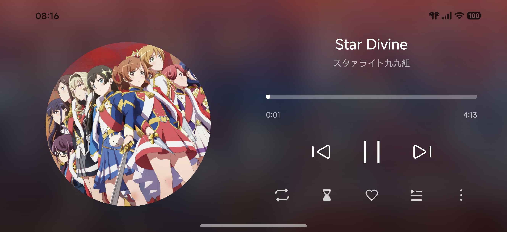</td>  
    <td>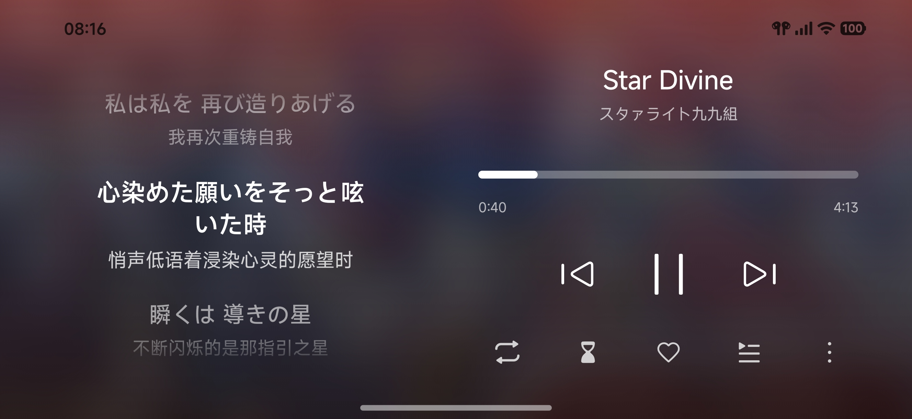</td>  
  </tr>  
</table>

## 特性

- 基于 GD Studio API，实现歌曲在线播放与下载、专辑与歌手详情查看等功能
- 基于 Compose Miuix 测试版本（miuix-glass）打造整体界面与控件，视觉效果与小米澎湃OS4协调一致
- 极致轻巧，安装包仅4MB出头，麻雀虽小五脏俱全
- 处处可见、称心如意、简单而不失优雅的细节动效
- 支持历史记录查询、本地歌曲播放、在线歌单导入、歌曲收藏等基础功能
- 首页歌曲推荐、背景自定义、音频淡入淡出、播放界面自定义、睡眠定时等特色功能

## TODO

- **播放界面展开动效**
- **播放界面歌词模糊**<br>以上两项在测试时曾有多次调试，但效果不佳。
- **对折叠屏、平板等大屏设备的界面适配**
- **音乐锁屏功能**<br>待小米官方推送该功能后适配。

## NOT TODO

- **Monet 取色、Monochrome 图标、预测返回**等原生特性
- **液态玻璃效果**<br>由于加入以上效果会破坏应用UI/UX体验上与小米澎湃OS的一致性、在一定程度上影响较低端手机的性能，故决定不做，在此表示抱歉。本仓库亦**不接受**相关 request，如有需求，请自行 fork 该仓库。
- **歌曲评论读取功能**<br>技术上可以实现，但本项目的宗旨之一是“以本地播放器的思维做在线音乐，精简为美”，故暂决定不做评论相关功能。如果需求较多，可考虑添加。
- **TME系（QQ/酷狗/酷我/JOOX）音源接入**<br>吃DMCA概率极高，故不添加。

## 运行要求

- 基于 `miuix-glass` 的运行要求以及安卓生态现状，本应用支持 Android 13（API 33）或更高版本的设备运行，在此向较低版本设备用户致歉
- 首次运行需授予通知和“音乐和音频”读取权限
- 本应用不保证在非小米澎湃OS设备上的运行效果，但理论上在其他安卓系统上的体验也较为完善（曾进行定向测试，效果较好）
- 当前 APK 仅提供 `arm64-v8a`

## 自行构建

```bash
# Release
./gradlew :app:assembleRelease

# Debug
./gradlew :app:assembleDebug
```

产物路径：

```
app/build/outputs/apk/release/app-release.apk
```

## 下载与安装

[GitHub Releases](https://github.com/misaka10902/HyperMusic/releases)

## 致谢

- [GD Studio](https://music.gdstudio.org/) - 音源服务提供
- [Otter Music](https://github.com/DJChanahCJD/otter-music) - 提供API接入思路
- [Compose Miuix](https://github.com/compose-miuix-ui/miuix) - 界面基础框架
- [AndroidX Media3](https://developer.android.com/media/media3) - 音频播放基础框架
- [Nexio Scheduler](https://github.com/HaoZai000/NexioSchedule) - 项目构建早期参考
- [Melox](https://github.com/Inefy-03/Melox) - UX细节方案提供

本项目由 WorkBuddy 协助开发，代码多有错漏之处，敬请见谅。欢迎通过 [Issues](https://github.com/misaka10902/HyperMusic/issues) 反馈问题或提交 [Pull Request](https://github.com/misaka10902/HyperMusic/pulls)
